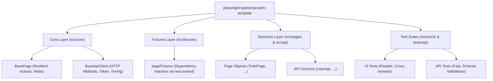

# 🎭 Playwright + TypeScript POM & SOM Automation Framework Template

[](https://github.com/louistr-9/playwright-typescript-pom-template/actions)


> **Production-ready, battle-tested Playwright & TypeScript test automation boilerplate** combining **Page Object Model (POM)** for UI testing and **Service Object Model (SOM)** for API testing with **Custom Fixtures (`test.extend`)**, cross-browser execution, and automated **GitHub Actions CI/CD pipeline**.

---

## 🌟 Key Architecture & Highlights



1. **Custom Test Fixtures (`test.extend`)**:
   - Zero boilerplate: Eliminates manual `const page = new Page(page)` across test files.
   - Page objects and API services are automatically instantiated and injected on-demand into test signatures (`async ({ todoPage, userApi }) => { ... }`).
2. **Page Object Model (POM) for UI**:
   - `BasePage` encapsulates robust interactions, auto-waiting, visual checks, and screenshot handling.
   - Clean separation of selectors and page actions.
3. **Service Object Model (SOM) for API**:
   - `BaseApiClient` handles request headers, bearer authentication, response time logging, and assertions.
4. **Cross-Browser & Responsive Ready**:
   - Pre-configured for Chromium, Firefox, WebKit (Safari), Mobile Chrome (Pixel 5), and Mobile Safari (iPhone 12).
5. **Automated CI/CD Pipeline**:
   - Ready-to-use GitHub Actions workflow (`.github/workflows/playwright.yml`) executing parallel test runs and uploading interactive HTML reports as downloadable artifacts.

---

## 📂 Project Structure

```text
playwright-typescript-pom-template/
├── .github/
│   └── workflows/
│       └── playwright.yml         # 🤖 Automated CI/CD test execution pipeline
│
├── src/
│   ├── core/                      # 🧱 Foundation Layer (Reusable across all projects)
│   │   ├── BasePage.ts            # - Core browser actions, waits, screenshots
│   │   └── BaseApiClient.ts       # - Core HTTP wrapper (GET, POST, PUT, DELETE, logs)
│   │
│   ├── fixtures/                  # 🧩 Dependency Injection
│   │   └── pageFixtures.ts        # - Custom test fixtures via test.extend
│   │
│   ├── pages/                     # 📄 Page Object Model (POM)
│   │   └── TodoPage.ts            # - Sample page actions & locators
│   │
│   ├── api/                       # 🌐 Service Object Model (SOM)
│   │   └── UserApi.ts             # - Sample API service calls
│   │
│   └── utils/                     # 🛠️ Helpers & Utilities
│       ├── env.helper.ts          # - Environment variables accessor
│       ├── data.generator.ts      # - Dynamic test data generation (email, string)
│       └── logger.helper.ts       # - Colorized execution logger
│
├── tests/                         # 🧪 Test Scenarios
│   ├── e2e/
│   │   └── todo.spec.ts           # - E2E UI test suite
│   └── api/
│       └── user-api.spec.ts       # - REST API test suite
│
├── .env.example                   # Environment configuration template
├── playwright.config.ts           # Playwright runner configuration
├── tsconfig.json                  # TypeScript compiler settings & path aliases
└── package.json                   # Project dependencies and script shortcuts
```

---

## 🚀 Getting Started

### 1. Prerequisites
- **Node.js**: v18 or later (v20+ recommended)
- **npm** or **pnpm**

### 2. Clone & Install

```bash
# Clone this repository
git clone https://github.com/louistr-9/playwright-typescript-pom-template.git my-test-project
cd my-test-project

# Install dependencies
npm install

# Install browser binaries with OS dependencies
npx playwright install --with-deps
```

### 3. Configure Environment

Copy the `.env.example` file to `.env`:
```bash
cp .env.example .env
```

---

## 🧪 Running Tests

| Command | Description |
| :--- | :--- |
| `npm test` | Run all test suites (UI + API) headlessly across configured projects |
| `npm run test:e2e` | Run only End-to-End UI tests |
| `npm run test:api` | Run only REST API tests |
| `npm run test:ui` | Open **Playwright Interactive UI Runner** with time-travel debugger |
| `npm run test:headed` | Run tests in headed browser mode (visible UI) |
| `npm run test:chromium` | Run tests exclusively on Google Chrome / Chromium |
| `npm run test:mobile` | Run tests on Mobile Chrome (Pixel 5 viewport) |
| `npm run report` | Open the interactive HTML test execution report |

---

## 🛠️ How to Extend for Your Own Project

### 1. Add a new Page Object (`src/pages/LoginPage.ts`)
```typescript
import { Page, Locator } from '@playwright/test';
import { BasePage } from '../core/BasePage';

export class LoginPage extends BasePage {
  readonly emailInput: Locator;
  readonly passwordInput: Locator;
  readonly submitButton: Locator;

  constructor(page: Page) {
    super(page);
    this.emailInput = page.getByPlaceholder('Email');
    this.passwordInput = page.getByPlaceholder('Password');
    this.submitButton = page.getByRole('button', { name: 'Login' });
  }

  async login(email: string, pass: string): Promise<void> {
    await this.fill(this.emailInput, email, 'Email Input');
    await this.fill(this.passwordInput, pass, 'Password Input');
    await this.click(this.submitButton, 'Login Button');
  }
}
```

### 2. Register in Custom Fixtures (`src/fixtures/pageFixtures.ts`)
Add your new page to the `TestFixtures` type and extend the fixture:
```typescript
export type TestFixtures = {
  todoPage: TodoPage;
  loginPage: LoginPage; // 👈 Add here
};

export const test = base.extend<TestFixtures>({
  loginPage: async ({ page }, use) => {
    await use(new LoginPage(page)); // 👈 Injected automatically
  },
});
```

### 3. Write your clean Test Case (`tests/e2e/login.spec.ts`)
```typescript
import { test, expect } from '../../src/fixtures/pageFixtures';

test('Should login successfully', async ({ loginPage, page }) => {
  await loginPage.navigate('/login');
  await loginPage.login('user@example.com', 'SecureP@ss123');
  await expect(page).toHaveURL('/dashboard');
});
```

---

## 📄 License

This project is licensed under the [MIT License](LICENSE).
Feel free to use it as a foundation for your personal portfolio, interview assignments, or enterprise automation projects.

